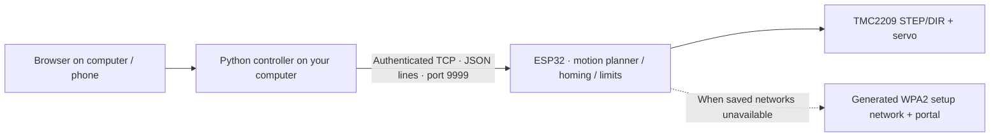

# Wireless control, setup, and recovery

## Architecture



The firmware uses the pinned Arduino-ESP32 Wi-Fi, WebServer, DNSServer, Preferences and mDNS libraries, plus ArduinoJson 6.21.5. The legacy UDP code is not enabled.

## First-time Wi-Fi setup

1. Flash the firmware and open USB serial at 57600 baud.
2. With no saved network, the ESP32 advertises Drawy-Setup-xxxxxx immediately. With saved credentials, it attempts a connection for about 15 seconds, then advertises setup if it cannot connect.
3. USB serial prints a **generated, per-device WPA2 setup password**. There is no home-network password or shared setup password in the source.
4. Join that setup network from a computer/phone. Open http://192.168.4.1 if the captive page does not appear.
5. Select/enter your 2.4 GHz SSID and password. The ESP32 saves up to three known networks in its NVS flash, tries the new network, and displays its IP when connected.
6. Copy the device pairing key shown on that page. This generated key authorizes the computer controller and is separate from the Wi-Fi password.
7. Rejoin your normal LAN, run the computer controller, and enter drawy.local or the numeric IP plus that pairing key.

While idle, sending WIFI SETUP over USB advertises setup and repeats the setup credentials. Disconnect the computer controller before using the portal. Setup HTTP is served only while motion is idle and no controller is authenticated, so a slow setup-page client cannot stall a drawing.

After station connection, setup remains available for about 60 seconds, then closes. When saved networks disappear, setup reappears and the robot periodically retries known networks; failed networks cool down so another saved network can be tried. Hidden SSIDs may be entered manually.

Credentials are stored on the ESP32, outside source control. This standard build does not enable encrypted NVS/secure boot: someone with physical flash access can retrieve stored secrets. The TCP control protocol is authenticated but not TLS-encrypted, and is intended for a trusted LAN.

References: [Espressif Wi-Fi API](https://docs.espressif.com/projects/arduino-esp32/en/latest/api/wifi.html), [Preferences API](https://docs.espressif.com/projects/arduino-esp32/en/latest/api/preferences.html). The implementation is compiled against the installed 2.0.17 headers.

## Commands and acknowledgements

Every TCP message is one JSON object followed by a newline. One controller owns motion. USB status/emergency-stop remain usable; other USB commands are blocked while wireless owns a job.

Handshake:

```json
{"type":"hello","session":"a-persistent-controller-UUID","token":"device-pairing-key"}
```

The reply reports a random boot ID, the bound session, next expected command ID, accepted/completed watermarks, queue/planner capacity, homing/fault/hold states, machine limits, configured pen angles, and position. Position is explicitly labelled planned while movement remains buffered, and settled when idle.

Numbered operations:

```json
{"type":"command","boot":"current-boot-id","id":1,"op":"home"}
{"type":"command","boot":"current-boot-id","id":2,"op":"move","x":200,"y":-300,"feed":10}
{"type":"command","boot":"current-boot-id","id":3,"op":"pen","angle":40}
{"type":"command","boot":"current-boot-id","id":4,"op":"sync"}
```

Examples are separate messages; replace the boot/session values with those from the device. The controller handles these details.

- An ack means accepted into a bounded command queue, not physical completion.
- completed advances only after dispatched movement has drained; pen commands also wait for 300 ms settling.
- Retrying identical bytes with the same ID returns a duplicate ack and never re-executes the command.
- Reusing an ID with different bytes, skipping IDs, stale IDs outside the 32-entry fingerprint cache, and commands with an old boot ID are rejected.
- Full buffers reject without consuming the ID. The computer waits on capacity reports.
- The controller sends a heartbeat every second. Missing traffic for five seconds loses the link.
- pause/resume/stop are priority controls outside the drawing queue. stop uses the same fault latch and motor shutdown as USB M112.

## Disconnect, pause, and resume

A connection failure or pause stops adding planner segments. Already-planned movement drains to its endpoint; the pen lifts and motors stay engaged. Accepted but undispatched commands remain in RAM. If the current long line was only partly planned, its remaining endpoint is retained.

Reconnecting does not resume motion. For the same boot/session and a still-valid physical position, explicit Resume restores the saved pen state, waits for settling, then continues the retained remainder and queue. Command IDs reconcile an acknowledgement lost just before disconnect.

Power loss/firmware reboot destroys this RAM recovery state. The computer detects a changed boot ID, marks the job interrupted, and blocks automatic resume. Rehome and explicitly restart the drawing; there is no claim of seamless recovery of a partially drawn page after power loss.

Homing aborted by link loss/pause latches a fault. Reset and inspect before trying again. A physical stop/power switch remains independent of network delivery.

## Verification and physical acceptance

Performed: firmware compilation; C++ geometry/homing/command-ledger tests under sanitizers; Python TCP/HTTP integration tests with fault injection; desktop browser verification of homing, generated-art preview, start, pause/pen-up, explicit resume, and stop/reset-required state against a simulated robot.

Still requires the actual machine:
- Provision with no credentials, correct/incorrect password, multiple saved networks, a hidden SSID, router unavailable at boot, and router loss during a drawing.
- Confirm AP fallback/reconnection and address discovery on your router.
- Verify 5-second heartbeat loss drains only planned motion, raises the physical pen, and holds motor position.
- Test stop during a long move and homing, repeated manual displacement/power loss/rehome, real pen settling, cable drag, temperatures, and grid accuracy.

These are commissioning checks, not completed bench results.
